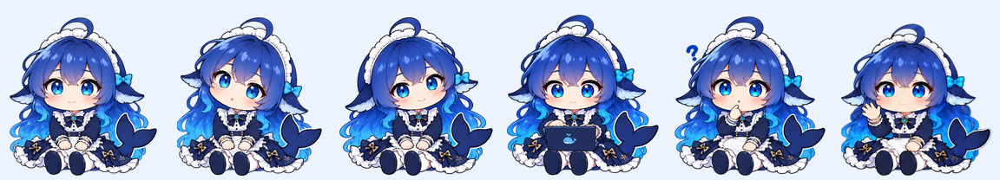

# 🐋 DeepCodex Pet · 大肥鱼 v3.1

一只用于 Codex dot 的蓝发鲸鱼娘桌宠，原名澜澜。坐在任务栏上方，晃晃脑袋，陪你一起开工。💙



**v3 · 2026-10-15 更新：** 全部动作统一为圆润的 Q 版坐姿，配色为靛蓝到青蓝的长发、蓝白女仆裙和小鲸尾，保持一致的头身比例。待机时轻轻左右歪头，工作时把笔记本放在腿上；鼠标互动时，露出手指抵唇、圆嘴、大眼睛和小问号的思考表情。

**v3.1 待机流畅更新：** 晃头改为 **72 帧、24 fps、3 秒循环**，用同一套头部与身体分层素材连续旋转，摆幅约 ±5°。裙摆、双脚和坐姿落点保持不动，六个原生待机槽位显示同一动画相位，切换槽位时不会跳姿态。

**本地与云端的区别：** 上述 24 fps 适用于直接读取本地 APNG 的加载方式。迁移到云端 Pets 后，服务会重新编码 PNG 并去掉 APNG 动画块；dot 使用云端版本时，应更新原有宠物条目为 [云端兼容精灵图](assets/spritesheet-cloud.png)。兼容版使用同一最新形象的六帧轻摆，不能达到本地版的 24 fps；仅重装本地文件不会更新已经迁移的云端角色。

[本次更新记录](CHANGELOG.md) · [云端 dot 替换说明](docs/cloud-dot-update.md)

| 🌊 本地 24 fps 晃脑袋 | 💻 笔记本工作 | 🤔 抵唇思考 |
|---|---|---|
|  |  |  |
| 👋 微笑挥手 | 🙌 等待回应 | 🥺 小小失落 |
|  |  |  |

[任务栏互动预览](previews/v3.html) · [深浅背景与小尺寸检查](previews/dot-compatibility.html) · [动作切换 GIF](previews/v3-transition.gif) · [完整动作巡览](previews/all-states.gif)

GitHub 首页可直接查看 GIF；互动 HTML 预览需下载仓库后在本地打开。小尺寸检查页建议通过本地 HTTP 服务访问。

## 版本选择

| 使用方式 | 素材 | 待机表现 |
|---|---|---|
| 直接读取本地文件的桌宠 | [spritesheet.png](assets/spritesheet.png) | 72 帧、24 fps、3 秒循环，±5° 晃头 |
| 云端 Pets / 已迁移的 dot 角色 | [spritesheet-cloud.png](assets/spritesheet-cloud.png) | 六帧轻摆，约 ±1.29°，沿用客户端播放节奏 |
| 需要静态待机 | [spritesheet-static.png](assets/spritesheet-static.png) | 待机保持坐姿，其他动作由客户端调度 |

云端兼容版的实际待机预览：


### 替换 dot 中原有的大肥鱼

如果原有角色已经迁移到云端，请使用 Pets 更新能力将 `assets/spritesheet-cloud.png` 替换到**现有“大肥鱼”条目**，保留原 ID，再激活同一条目，并将 dot 形象设为桌宠 / Pet。更新流程和回读检查见[云端 dot 替换说明](docs/cloud-dot-update.md)。

可直接向支持 Pets 工具的助手提出：

> 请用仓库中的 assets/spritesheet-cloud.png 更新已有的“大肥鱼”，保留原 ID 并激活，让 dot 使用这个最新坐姿版本。

## 安装到本机 Codex（Windows）

下载仓库后运行安装脚本，安装预制素材无需安装 Node.js 或构建依赖：

```powershell
git clone https://github.com/PatrickStar-cmd/DeepCodex-pet.git
cd DeepCodex-pet
./scripts/install-dot.ps1
```

已经克隆仓库的用户，更新后在仓库根目录重新运行 `./scripts/install-dot.ps1` 即可。

默认安装包含连续晃头的 APNG 精灵图。需要静态待机时运行 `./scripts/install-dot.ps1 -StaticIdle`：客户端自身的“减少动态效果”只能冻结动作槽位，无法暂停 PNG 文件内部的动画。静态版保留工作、悬停等动作供客户端调度。

安装名称为 **大肥鱼**，稳定 ID 为 `custom:deepcodex-lanlan`。更新时自动备份旧素材，已选择该角色时沿用原 ID。若界面仍显示旧素材，重新进入 Pets 设置选择大肥鱼，必要时重新打开客户端。

首次使用：在 Codex Pets 设置选择大肥鱼，再将 dot 形象设为桌宠 / Pet。任务栏位置由 Codex 的 dot 布局控制；本仓库负责角色坐姿和动作素材。

当前客户端的桌宠按钮悬停会播放思考动作；dot 待机时跟随鼠标使用同款思考表情的十六向素材。dot 工作时保持笔记本动作，鼠标注视目前仅在待机时启用。详见 [v3 更新与兼容说明](docs/seated-v3-update.md)。

## 素材与构建

| 路径 | 内容 |
|---|---|
| [assets/spritesheet.png](assets/spritesheet.png) | 当前原生完整精灵图 |
| [assets/spritesheet-v3.png](assets/spritesheet-v3.png) | v3 同内容版本副本 |
| [assets/spritesheet-static.png](assets/spritesheet-static.png) | 静态待机兼容版 |
| [assets/spritesheet-cloud.png](assets/spritesheet-cloud.png) | 云端 Pets 六帧轻摆兼容版 |
| [pet.json](pet.json) | 角色配置、动作槽位和 SHA-256 |
| [source/v3/](source/v3/) | ImageGen 原始透明输出和坐姿锚点 |
| [source/v3-smooth/](source/v3-smooth/) | 晃头分层素材及 72 张连续运动帧 |
| [source/frames/](source/frames/) | 当前 57 张动作帧和 16 张注视帧 |
| [prompts/v3/](prompts/v3/) | 生成与修正提示词 |
| [qa/v3-registration.json](qa/v3-registration.json) | 统一缩放和坐姿基线记录 |
| [source/revisions/pre-seated-v3/](source/revisions/pre-seated-v3/) | 更新前配置和精灵图备份 |

```powershell
npm install
npm run build:v3
npm run validate
```

仅重建云端兼容素材：`npm run build:cloud`。仅重建本地连续晃头及其兼容素材：`npm run build:idle`。

v3 是角色素材版本；原生文件继续使用客户端支持的 **sprite v2** 格式：1536 × 2288 RGBA PNG，8 列 × 11 行，每格 192 × 208。有效槽位 73 个，空白槽位 15 个。构建按每套生成图使用一个统一缩放比例，并将坐姿落点统一到单元格 y=203。

| 行（从 0 开始） | 状态 | 帧数 | v3 动作 |
|---|---|---|---|
| 0 | `idle` | 6 | 坐姿左右晃脑袋 |
| 1 / 2 | `running-right` / `running-left` | 各 8 | 坐姿移动时的头部动作 |
| 3 | `waving` | 4 | 坐姿微笑挥手 |
| 4 | `jumping` 槽位 | 5 | 手指抵唇的思考表情 |
| 5 | `failed` | 8 | 小小失落后恢复微笑 |
| 6 | `waiting` | 6 | 坐姿摊掌等待 |
| 7 | `running` | 6 | 坐姿笔记本打字 |
| 8 | `review` | 6 | 笔记本注视、轻点头和眨眼 |
| 9 / 10 | 鼠标注视 | 16 | 思考表情，顺时针十六向注视 |

v3.1 的待机连续动画独立于客户端的六帧槽位时钟，一轮为 3 秒；工作沿用客户端时长，一轮 0.82 秒。GIF 与互动预览展示同一套连续运动帧。角色与头身分层素材由内置 ImageGen 生成，再完成旋转动画渲染、透明边缘清理和打包。

详见 [待机流畅更新说明](docs/idle-smooth-update.md)。

## 验证状态

当前 v3 已通过精灵图格式、哈希、73 个有效槽位与透明边缘检查；互动预览已检查九种状态、悬停与离开恢复、持续工作循环、减少动态效果及任务栏坐姿基线。记录见 [素材检查](qa/dot-compatibility.json) 和 [预览检查](qa/v3-preview.json)。真实 Codex 界面的完整交互仍待复现，客户端行为依据本机版本核查结果。

## 灵感与历史记录

澜澜参考 DeepSeek 鲸鱼娘的蓝白配色、鲸鱼元素与女仆形象，以 Q 版动漫风格重新生成；v3 思考表情参考用户提供的坐姿图片。

[dot 适配历史](docs/dot-adaptation.md) · [原困倦待机](docs/sleepy-idle-update.md) · [原歪头动作](docs/head-tilt-update.md) · [社区动作研究](docs/github-animation-study.md)

历史说明中的站姿、困倦点头与旧截图属于 v3 前版本，当前素材以本页和 v3 更新记录为准。
